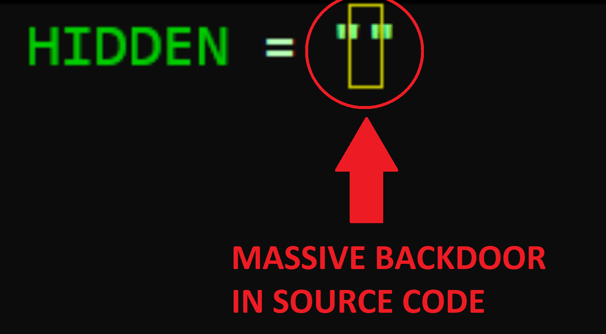

# Invisible Payloads: Hiding Code in Unicode Variation Selectors

How what looks like a single char can hold a literal chunk of code python actually runs

## What's going on?

Unicode has a range of characters called **variation selectors**: `U+FE00–U+FE0F` (16 values) and `U+E0100–U+E01EF` (240 values). Their job is to tell fonts "render the previous character differently". They're invisible & combine with the character before them, Python sees it as a printable character, so it can be used in code without throwing any errors.
That's 256 possible invisible characters.

- The encoder `encoder.py` map each byte into a variation selector and automatically copies it to clipboard if you are on Windows
- The decoder `decoder_function.py` map the variation selectors into the original bytes and then hands it to Python's `compile()` which turns the recovered source string into a code object `exec()` can run.

To learn more about it you can read my article : https://notyetavailable.invalid

## Disclaimer

This is for **educational purposes only**. It's a demonstration of how Unicode can be abused to hide data in plain sight, not a tool for doing anything malicious. Don't use it in other people code without their permissions, don't use it to deceive, attack, or mess with systems or people you don't own or have permission to test.
